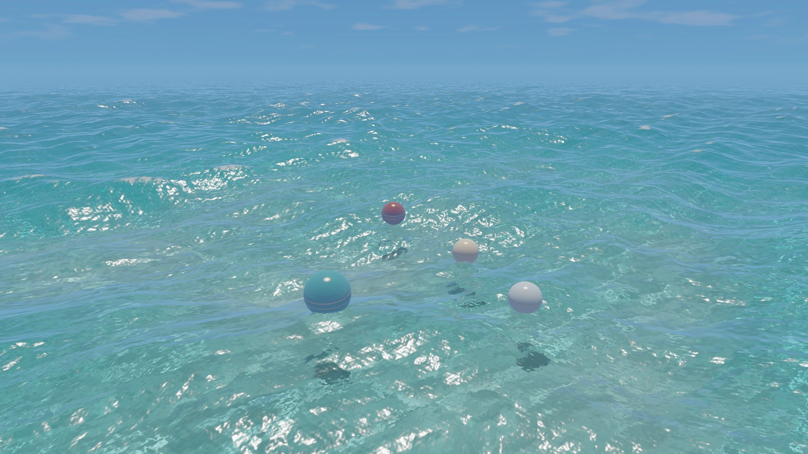
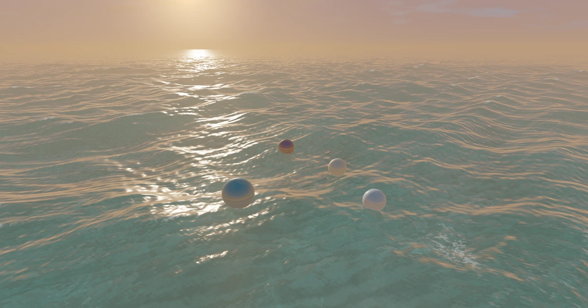
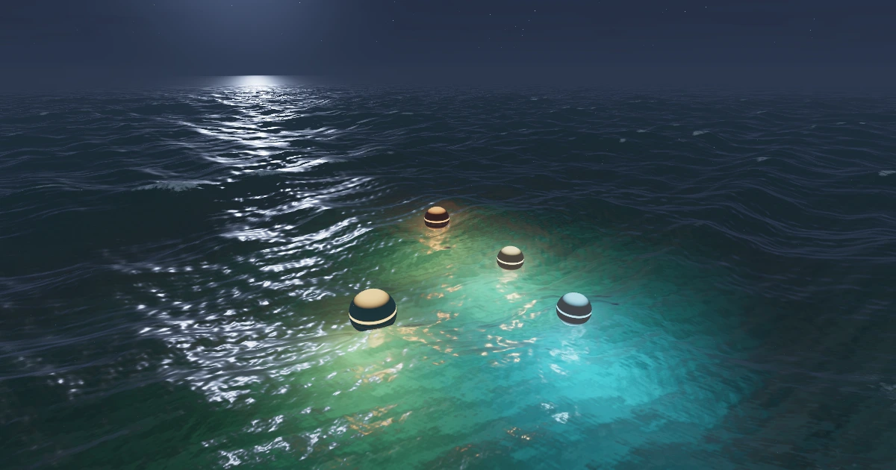

# Glasswater 1.0 — Lagoon

Sweep a hand through a sunlit lagoon. Turn the light down and watch the floating spheres illuminate the water below them. Glasswater is an interactive ocean built entirely in code with WebGL 2 and JavaScript.

[Play the live demo](https://chatgpt.256pages.com/glasswater/) · [Configuration and API](API.md) · [Embed example](examples/embed.html)

## Quick start

- Open `Glasswater-v15.html` directly in a WebGL 2 browser. This is the approved, self-contained V15 visual reference.
- To edit or embed the project, serve this directory with `python3 -m http.server 8080` and open <http://localhost:8080/>. The editable version loads native ES modules. It needs no build step, npm install, remote assets or network service.
- Move the mouse or sweep one finger to make waves. Drag with the mouse or move two fingers to orbit. Use Light / Environment and Water / Optics to adjust the scene.

## Reuse

`index.html` owns the control markup. `src/lagoon.css` owns the canvas and overlay layout. `src/lagoon.js` contains the annotated simulation, WebGL renderer, camera and controls. Deploy those three files with their relative paths intact to embed the scene. The [example](examples/embed.html) starts the scene at dusk and lets you change depth from the parent page. The [API guide](API.md) documents the existing hooks, bounds and units.

## How it works

- The CPU advances two damped height grids at a fixed timestep. Pointer strokes add velocity disturbances. Analytic swells drive the background motion and interact with the near grid around the spheres. The renderer samples the two grids from packed textures.
- The spheres follow sampled surface height and slope. A six-pass horizontal contact solver separates overlapping spheres and applies an impulse when they move toward one another.
- WebGL 2 draws the procedural sky, displaced ocean mesh and spheres. An offscreen foam pass preserves short-lived surface detail. The seabed light map projects sunlight through local surface normals, accumulating caustics and attenuation from the spheres. After dark, shader-based coloured light illuminates the water below the floats.
- The offscreen passes limit their update rates. The visible pass caps render resolution and reduces it after sustained slow frames. GPU timings are optional and use the browser's disjoint timer query extension.

## Requirements and limits

Use a current browser with WebGL 2 and working GPU acceleration for interactive use. Render speed depends on viewport, device, browser and scene settings. Height fields represent one surface elevation per point. Refraction, seabed lighting and collisions are approximations. The orbit stays above the water and within the study’s camera limits. The page exposes one scene per document. For multiple scenes, use separate iframes. Hardware ray tracing, WebGPU and volumetric fluid dynamics are outside this release.

ChatGPT developed the experimental studies. Codex prepared the release, integration and verification. MIT applies to this standalone Glasswater project. See [LICENSE](LICENSE).
